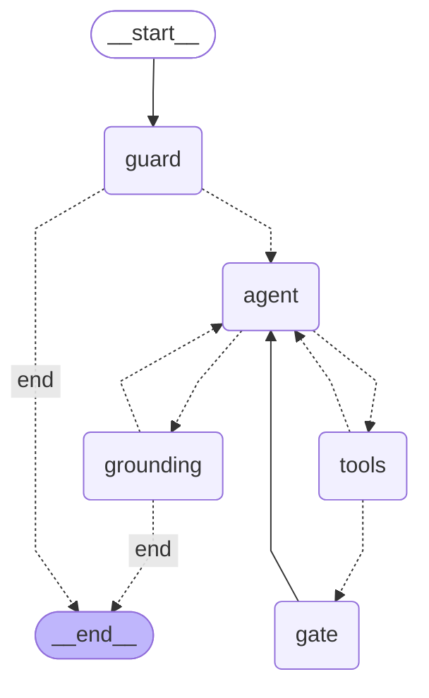

# Revenue Leakage Agent

A stateful, conversational "financial detective". It investigates billing plans against invoices, explains what it finds with the calculation behind each figure, and proposes corrections. Every correction is a proposal. Nothing is written to the sandbox until a human approves it in the chat.

- **Live API docs:** `backend/` → `uvicorn app.main:app`, then open `/docs`. A static copy is in [`docs/architecture/openapi.json`](docs/architecture/openapi.json).
- **Agent graph and tools:** see [Agent graph](#agent-graph) and [Tools](#tools) below.
- **How gaps are detected:** [`docs/architecture/business_logic.md`](docs/architecture/business_logic.md).

## Quick start

```bash
docker compose up -d                       # Postgres 16 on localhost:5433
cp .env.example .env                       # set ANTHROPIC_API_KEY (and optional Langfuse keys)

cd backend && uv sync
uv run uvicorn app.main:app --port 8000    # API + /docs

cd ../frontend && npm install && npm run dev   # UI on http://localhost:5173
```

Tests:

```bash
cd backend && uv run pytest                # 158 offline tests; `-m live` runs the opt-in Claude smoke test
cd frontend && npm test && npm run build
```

Regenerate the architecture artifacts after changing routes or the graph:

```bash
cd backend && PYTHONPATH=. uv run python scripts/export_docs.py
```

## Architecture

```
frontend (React, Vite)                 chat, approval card, audit tab
   │  HTTP + X-User-Id
backend/app
   ├── api/          routes only: validation in, JSON out
   ├── agent/        LangGraph graph, nodes, state, service
   ├── tools/        read · propose · write · registry (what the model can see)
   ├── domain/       detection and money math. Pure Python, Decimal, no LLM, no I/O
   ├── storage/      read-only JSON loaders · sandbox writer · Postgres users and checkpointer
   ├── guardrails/   injection patterns · semantic classifier · numeric grounding
   └── observability/ PII scrubber · Langfuse wiring
```

### Decisions and why

1. **The domain decides what a finding is; the LLM only chooses tools and writes prose.** Detectors, money and FX are plain Python in `domain/`, with no imports from agent, API or storage. Every finding carries its numbers and a calculation trail, so the model quotes rather than computes.
2. **`Decimal` everywhere, floats rejected.** Money is quantized to cents with HALF_UP. Loaders parse JSON numbers straight to `Decimal`. A `Money` type refuses cross-currency arithmetic, and conversion is an explicit step with evidence.
3. **Nothing is precomputed or cached.** Each question recomputes from the ledger (source files plus the sandbox overlay). A stored finding would go stale after an approval, so no findings are persisted.
4. **Proposal, then approval, then write.** The LangGraph `interrupt()` is the first effect in the approval gate. A paused graph has written nothing. Approve re-derives the proposal from the current ledger and writes once. Reject logs an audit event and writes nothing.
5. **Write functions are unreachable by the model.** `apply` and `rollback` live in `tools/write.py`. The model's toolset (`tools/registry.py`) is built from read and propose specs only, and a test asserts that `apply` and `rollback` are not bound. The only caller is the approval gate.
6. **Sandbox is JSON, guarded by a lock.** The brief asks for `data/sandbox/` JSON. Writes take a process lock and an `fcntl` file lock, and each file is replaced atomically. `audit_log.json` has no update or delete operation.
7. **Follow-ups resolve from state.** The plan in focus, the as-of date and the pending proposal are part of the graph state. "What currency is that plan in?" resolves to the last plan loaded, with no plan id in the question.
8. **Dummy login maps a user id to a stable thread.** The thread id is `uuid5(user_id)`, so logging in again resumes the same conversation. The server resolves the thread, so the client never sends one.
9. **Claude models from the brief's naming.** `claude-sonnet-5-5` runs the agent and `claude-haiku-5-5` runs the guard classifier. Both are configured in `.env`.

## Agent graph

Generated from the compiled LangGraph by `backend/scripts/export_docs.py`. Full output: [`docs/architecture/agent_graph.md`](docs/architecture/agent_graph.md).



ASCII version:

```text
                     +-----------+                       
                     | __start__ |                       
                     +-----------+                       
                            *                            
                            *                            
                            *                            
                       +-------+                         
                      .| guard |                         
                 ..... +-------+                         
             ....               .                        
        .....                    ..                      
   .....                           .                     
...                             +-------+                
.                               | agent |*               
.                             ..+-------+ ***            
.                          ...       .       ***         
.                       ...           .         ***      
.                     ..              .            ***   
.           +-----------+         +-------+           ** 
 ..         | grounding |         | tools |          **  
   ..       +-----------+         +-------+         *    
     .        .                           .        *     
      ..    ..                             ..    **      
        .  .                                 .  *        
    +---------+                           +------+       
    | __end__ |                           | gate |       
    +---------+                           +------+       
```

| Node | What it does |
|---|---|
| `guard` | Resets the turn counters. Refuses injections, off-topic turns and turns the classifier cannot check. Uses the previous assistant message as context, so a short reply such as "yes" is judged in context. |
| `agent` | Calls the model with the tools bound and the as-of date and plan in focus. Stops after 8 model calls. |
| `tools` | Runs each requested tool through the registry. A returned proposal becomes the pending one. A second proposal in the same batch is refused. |
| `gate` | The approval gate. Calls `interrupt()` before any write. Approve re-derives the proposal and writes once. Reject, or any other decision, writes nothing and logs an audit event. |
| `grounding` | Checks that every money figure and ISO date in the answer appears in a tool result or the user's messages. Allows one rewrite, then falls back to a safe answer. |

## Tools

The model sees 12 tools. They come from `backend/app/tools/registry.py`, and their schemas are generated from the same argument models that validate calls.

| Tool | Kind | Arguments | What it does |
|---|---|---|---|
| `load_plan` | read | `plan_id` (optional) | Returns one plan, its amendment family, active windows and expected periods. Puts the plan in focus. |
| `list_plans` | read | `customer_name` (optional) | Lists plans, optionally for one customer. |
| `query_invoices` | read | `plan_id`, `customer_name`, `date_from`, `date_to`, `status` (all optional) | Filters invoices by plan, customer, issue-date range or status. |
| `fx_convert` | read | `amount`, `from_currency`, `to_currency`, `on_date` (optional) | Converts an amount with the domain FX rule and shows the evidence. |
| `investigate_plan` | analysis | `plan_id` (optional) | Runs every detector live for one plan's family. Returns findings with calculation trails. Puts the plan in focus. |
| `scan_book` | analysis | none | Runs every detector across all plans. Returns counts, every money finding with ISO periods, the shortfall per currency, and other findings. |
| `scan_customer` | analysis | `customer_name` | Investigates all plans of a customer, including orphan invoices that point at them. |
| `set_as_of_date` | state | `as_of` (ISO date) | Changes the investigation date for this conversation. |
| `propose_make_good_invoice` | propose | `plan_id`, `period_start`, `amount` (all optional) | Drafts a make-good for a missing or underbilled period. Writes nothing until approved. |
| `propose_credit_memo` | propose | `invoice_id`, `amount` (optional) | Drafts a credit memo for an overbilled invoice. Writes nothing until approved. |
| `propose_plan_amendment` | propose | `plan_id`, `effective_date`, `new_total`, `new_cadence`, `add_entitlements` | Drafts an amendment effective from a date. Writes nothing until approved. |
| `propose_rollback` | propose | `action_id` (optional, defaults to the latest applied action) | Drafts an undo of an applied action. Writes nothing until approved. |

**Not exposed to the model:** `apply_pending` and `reject_pending` (`tools/write.py`). Only the approval gate calls them, after a human decision. The write functions are not in the registry, and a test checks that `apply` and `rollback` are never bound to the model.

**Amount rule for every propose tool:** `amount` is optional and can only lower the domain's figure. A larger value is refused.

## Guardrails

| Layer | What it does | Where |
|---|---|---|
| Input validation | User id pattern, message ≤ 2000 chars, decision is `approve` or `reject`. Tool arguments forbid unknown keys. | `api/schemas.py`, `tools/registry.py` |
| Injection patterns | Deterministic patterns for overrides, prompt-extraction, role changes, and attempts to call write tools or skip approval. | `guardrails/injection.py` |
| Semantic guard | Haiku returns `on_topic` and `injection`. Injection means bypassing approval, overriding instructions or revealing configuration. Asking to propose or undo a change is allowed. | `guardrails/topic.py`, `agent/nodes/` |
| Fail closed | If the classifier errors, the turn is refused. Refused turns never reach the model or the tools. Refusals are fixed text. | `agent/nodes/` (`guard`) |
| Structural write isolation | No write function is in the model's toolset. The gate is the only caller. | `tools/registry.py`, `agent/nodes/` (`approval_gate`) |
| Human approval | Interrupt before any write. Only one proposal may wait. Messages sent while one waits are refused without a model call. | `agent/nodes/`, `agent/service.py` |
| Stale-proposal check | Before writing, the proposal is re-derived. A changed amount refuses the write. | `tools/write.py` |
| Amount control | The domain sets amounts. A user-supplied amount can only lower a make-good or credit memo. | `domain/proposals.py` |
| Numeric grounding | Every figure in an answer must appear in a tool result or the user's message. One regeneration, then a safe fallback. Plan and invoice ids are excluded. | `guardrails/grounding.py`, `agent/nodes/` (`grounding`) |
| Untrusted data | Notes and invoice descriptions are flagged as data in tool results. The system prompt forbids following instructions found in them. | `tools/serialize.py`, `agent/prompts.py` |
| Loop budget | At most 8 model steps per turn. | `agent/nodes/` |
| Source immutability | The four source files are read only. A test checks byte identity after apply and rollback. | `storage/loaders.py`, `tests/storage/test_ledger.py` |
| PII before observability | Emails, phones, IBANs and card numbers are masked. Customer names become stable tokens, and user ids are hashed. This applies to Langfuse traces and to logs. | `observability/pii.py` |
| CORS | Only configured origins may call the API. | `main.py`, `settings.py` |

**Known limits.** Login is a dummy by design: anyone who knows a user id can open that conversation. There is no rate limiting and no TLS in the dev setup. The semantic guard runs only when an API key is set. Prompt-injection defence is layered, not perfect. The approval gate, not the model, is what guarantees that nothing is written without a human decision.

## Memory: what is remembered, and where

| Memory | Type | Where it lives | Lifetime |
|---|---|---|---|
| Conversation messages | Short-term, per thread | LangGraph checkpoint in Postgres (`checkpoints*` tables) | Until the thread is deleted |
| Focus and as-of state (`active_plan_id`, `as_of`) | Short-term, per thread | Same checkpoint, in the graph state | Same |
| Pending proposal | Short-term, per thread | Graph state and the interrupt payload, same checkpoint | Until approved or rejected |
| User → thread mapping | Long-term identity | Postgres `users` table (`user_id`, `thread_id`) | Permanent |
| Applied sandbox records | Long-term business state | `data/sandbox/{plans,invoices,credit_memos}.json` | Until rolled back |
| Applied-action registry | Long-term index for rollback | `data/sandbox/applied_actions.json` | Same as the records |
| Audit trail | Long-term, append-only | `data/sandbox/audit_log.json` | Permanent |
| Source data | Read-only reference | `data/technical-case/data/*.json` | Never written |
| Findings and amounts | **Not stored** | Recomputed on every question | — |
| Traces | Observability | Langfuse (masked before sending), when keys are set | Per Langfuse retention |
| Signed-in user id | Browser convenience | `localStorage` key `rla.userId` | Until sign-out |

## Business logic in brief

Expected billing comes from the plan's total value and cadence, over an assumed 12-month term, with amendments cutting the base at their start date. Each period is compared with its invoices, converted to the plan currency on the issue date, net of credit memos. Shortfalls become make-good proposals, excesses become credit memo proposals, and periods with no invoice are missing. Orphan invoices, window violations, unknown plans, credit-memo anomalies, overdue invoices and unevidenced entitlements are reported as separate findings. Full rules and a worked example: [`docs/architecture/business_logic.md`](docs/architecture/business_logic.md).

## Repository map

```
backend/app/            application code (see Architecture)
backend/tests/          pytest suites per layer (domain, storage, tools, agent, api, guardrails, observability)
backend/scripts/        export_docs.py (OpenAPI and graph artifacts)
frontend/src/           React UI and vitest tests
docs/architecture/      generated OpenAPI and graph, business logic
data/technical-case/    challenge data (read-only)
data/sandbox/           writable ledgers and audit log (git-ignored)
candidate_prompts.md    AI tool usage log, as the brief requires
```
