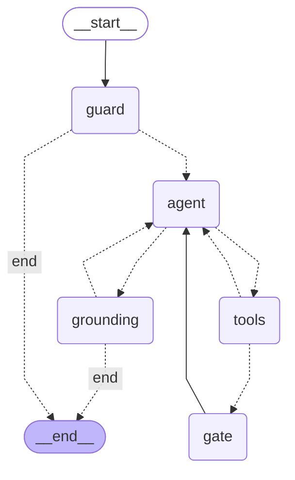

# Agent graph

Generated by `backend/scripts/export_docs.py` from the compiled LangGraph. Do not edit by hand.

## Mermaid



## ASCII

```text
                     +-----------+                       
                     | __start__ |                       
                     +-----------+                       
                            *                            
                            *                            
                            *                            
                       +-------+                         
                      .| guard |                         
                 ..... +-------+                         
             ....               .                        
        .....                    ..                      
   .....                           .                     
...                             +-------+                
.                               | agent |*               
.                             ..+-------+ ***            
.                          ...       .       ***         
.                       ...           .         ***      
.                     ..              .            ***   
.           +-----------+         +-------+           ** 
 ..         | grounding |         | tools |          **  
   ..       +-----------+         +-------+         *    
     .        .                           .        *     
      ..    ..                             ..    **      
        .  .                                 .  *        
    +---------+                           +------+       
    | __end__ |                           | gate |       
    +---------+                           +------+       
```
